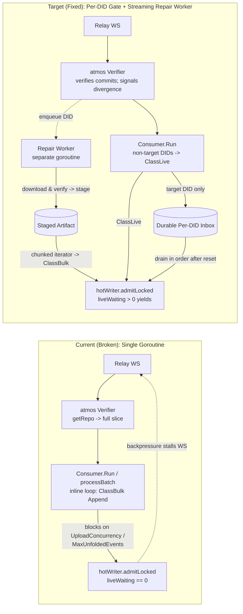

# Jetstream Resync Stall: Root Cause & Permanent Fix

**Date:** 2026-11-24
**Incident:** PD #5913 (`pop1` Jetstream live-ingest stall)
**Related:** `specs/notes/2026-11-23-online-account-redownload.md`, `APP-4027`, GitHub issue `#273`, `bsky-infra/docs/2026-10-20-jetstream-pop1-ingest-stall-rca.md`

## Non-Technical TL;DR

**What happened:** On 2026-11-24, an external PDS (`pds.pdsblock.network`) hosting large block-list accounts triggered automatic full-account resyncs on Jetstream `pop1`. Re-archiving a single large account took ~40 minutes and stalled the entire live Bluesky firehose on `pop1`, causing the upstream relay to repeatedly disconnect Jetstream and leaving downstream consumers (public `jetstream.us-west`, `safetykit`, `attie-ingest-v2`) stale.

**Why it happened:** Jetstream already has a traffic-isolation system meant to keep heavy background work from slowing down live events, **but automatic resyncs accidentally run on the same thread that reads the live firehose.** When Jetstream throttles a giant resync to protect storage, it pauses its own firehose reader. On top of that, a single resync holds multiple full copies of the account in memory and loses all progress on restart.

**Why this will keep happening until fixed properly:** This is not specific to `pdsblock.network`. Any account on any PDS with hundreds of thousands of records that diverges on the firehose can trigger the same outage, and blocking hosts one by one does not fix the underlying defect.

**The permanent fix:**
1. **Move automatic resyncs off the live firehose path** onto the same isolated, crash-resumable repair pipeline already being designed for single-account operator repairs (`specs/notes/2026-11-23-online-account-redownload.md`).
2. **Stream resync records from a staged repository copy** via a bounded iterator instead of materializing whole repositories into memory multiple times.
3. **Stop `atmos` from running full-repo downloads and returning materialized slices inline** on the firehose consumer path.
4. **Add an integration test** that simulates a giant resync against high-latency storage under live traffic so this failure mode cannot regress.

---

## Technical Explanation

### 1. Why Live Ingest Stalled Despite Bulk Admission Control

Jetstream's disaggregated hot writer (`internal/ingest/admission.go`) separates traffic into `ClassLive` and `ClassBulk`. Rule 1 (`admission.go:106-107`) ensures bulk work yields whenever a live append is waiting (`h.liveWaiting.Load() > 0`), and caps in-flight bulk work by `UploadConcurrency` (`8`) and `MaxUnfoldedEvents` (`65,536`).

Automatic Sync 1.1 resyncs defeat this mechanism completely:

1. `Consumer.Run` (`internal/ingest/live/consumer.go:566-580`) consumes `client.Events(ctx)` on a **single goroutine**.
2. In `processBatch` (`consumer.go:809-867`), when a resync event arrives (`evt.Resync != streaming.ResyncNone`), Jetstream tags the context `ClassBulk` and calls `c.writer.Append(appendCtx, &segEvts[i])` **one row at a time, synchronously, on that same goroutine**.
3. Once the resync saturates `UploadConcurrency` (8 frozen bulk batches) or `MaxUnfoldedEvents` (65,536 events, ~16 blocks), `hotWriter.admitLocked` (`admission.go:65-96`) blocks the goroutine waiting for Postgres commits and folds to drain.
4. Because the live consumer *is* the blocked goroutine, `h.liveWaiting.Load()` is always `0`. Bulk never yields, `client.Events` stops draining, the websocket backs up, and the relay disconnects Jetstream (`ConsumerTooSlow`).
5. On `pop1`, ~59 ms RTT to RDS `us-east-2` limits serialized fenced transactions (`hot_batch` + `fold`) to ~2.9 blocks/s (~11–12k rows/s), turning one large block-list repo into a multi-tens-of-minutes firehose stall. (`pop2` survived the same burst only because its DB RTT is ~28 ms/tx.)

### 2. Four-Layer In-Memory Materialization

Although `streaming.Event.Operations()` returns `iter.Seq2[Operation, error]` (`atmos@v0.8.0/streaming/operation.go:86`), resync events are materialized as full in-memory slices **before** iteration begins:

| Layer | Location | Allocation |
| --- | --- | --- |
| 1 | `atmos/sync/verifier.go:1333` (`resyncFetch`) | Full CAR loaded into RAM (`repo.LoadFromCAR`) |
| 2 | `atmos/sync/verifier.go:1397-1430` (`resyncApplyLocked`) | Full MST walk into `[]sync.VerifierOp`, held in `v.resyncOutbox` |
| 3 | `atmos/streaming/client.go:1545-1575` (`convertVerifierOps`) & `verify_worker.go:109` | Second full struct slice `[]streaming.Operation` on `evt.verifiedOps` (pins CAR block bytes) |
| 4 | `internal/ingest/live/events.go:357-441` (`convertSync`) | Third full slice `[]segment.Event`, cloning every record's CBOR bytes (`append([]byte(nil), block...)` at line 433) |

By contrast, `internal/ingest/backfill/handler.go:116-200` already avoids layers 2–4 by walking `r.Tree.Walk` into a reused 1,024-event batch and calling `writer.AppendBatch` without cloning record bytes.

### 3. Crash-Restart Amplification and Unbounded Budgets

- **Zero crash resumability:** `syncstate` promotion only triggers on the *last* row of a resync (`consumer.go:850-852`). Any leader restart mid-resync discards all progress and restarts from row 0.
- **Per-DID, in-memory-only rate limiting:** `internal/jetstreamd/session.go:40,111-121` sets `resyncBurst = 1` per DID per `ResyncInterval` (10m) in RAM. A restart clears every bucket; a PDS hosting 66 large accounts gets 66 independent budgets; and a single repo taking >10 minutes to write keeps bulk saturated indefinitely.
- **Why existing tests missed it:** `internal/ingest/live/resync_class_test.go` only asserts that 1-row `ResyncAsync` and `ResyncSyncEvent` events land in a `bulk` batch against an instant in-memory `storagefake`. It never exercises backpressure, multi-block resyncs, or concurrent live traffic.

### 4. Gap in the 2026-11-23 Account Repair Design & `atmos` Coupling

- `specs/notes/2026-11-23-online-account-redownload.md` already designs the right primitives (per-DID gate, durable inbox, immutable staging, resumable bulk batches, pre-reset headroom check), **but scopes them only to one manual operator repair at a time** (APP-4027). Automatic Sync 1.1 resyncs for every other DID still hit the broken inline path, and lines 139–147 still accept materialized `ResyncAsync` groups inside the consumer callback.
- **Ungated `ClassBulk` vs `ClassLive` race on the same DID (`RunFailedRepoRetry`):** `hotWriter` (`internal/ingest/admission.go`) is DID-unaware and preempts `ClassBulk` between chunks whenever `liveWaiting > 0`. In steady state, `RunFailedRepoRetry` (`internal/ingest/backfill/retry.go:153`, run concurrently by `orchestrator/steady.go:131-153`) is the other `ClassBulk` producer and streams `HandleRepoResync` (`KindSync` + 1,024-row `KindCreateResync` batches) **with no per-DID gate**. If a `StatusFailed` DID emits a live event during download or between bulk chunks, that event takes `ClassLive` and interleaves with the DID's own `ClassBulk` replacement — letting `KindSync` wipe a newer live commit or letting a later `KindCreateResync` chunk resurrect a live delete/update. (`2026-11-23-online-account-redownload.md` only fenced retries against an active manual repair via a repair generation counter, not against ordinary live traffic. `RunPendingRepoRetryPass` in `orchestrator/merge.go:225` does not have this race because it completes before `runSteadyState` starts the live consumer.)
- In `atmos@v0.8.0`, switching to `PolicyError` is **not sufficient on its own**: `VerifyCommit` honors `PolicyError` (`atmos/sync/verifier.go:2439-2446`), **but `VerifySync` ignores `Policy` and unconditionally runs `resyncFetch` + `resyncApplyLocked` inline** (`verifier.go:2637-2667`). Fixing this cleanly requires an `atmos` change.

---

## Permanent Fixes

### Fix 1: Unify All Repo Resyncs onto One Gated, Staged, Off-Hot-Path Pipeline

Treat **automatic Sync 1.1 chain-break / `#sync` resyncs**, **steady-state failed-repo retries (`RunFailedRepoRetry`)**, **operator account repairs (APP-4027)**, and **verify-queue drop repairs (issue `#273`)** as a single subsystem: a durable, per-DID repair queue owned by the active writer session.

- **Invariant — never mix `ClassLive` and `ClassBulk` for the same DID:** `hotWriter` stays DID-unaware; every steady-state `ClassBulk` producer emitting `KindSync` + replacement rows must publish behind the per-DID gate. A DID with `ClassBulk` work in flight never takes `ClassLive`.
- **Per-DID gate + durable inbox (from `2026-11-23-online-account-redownload.md`):** Before a DID begins `ClassBulk` reset/replacement output, the gate activates for that DID so its incoming live events route to its durable inbox (committed alongside the relay cursor in the writer's durable batch). Every other DID stays on `ClassLive` without waiting. After the final `ClassBulk` replacement chunk commits, the inbox drains in order — skipping repo ops at `rev <= snapshot.Rev`, applying ops at `rev > snapshot.Rev`, and preserving account/identity delivery order — and only then reopens the gate to `ClassLive`.
- **Separate worker goroutine(s) using `ClassBulk` + `AppendBatch`:** Because live ingestion stays on `Consumer.Run` while repair writes run on a separate bulk goroutine, `hotWriter`'s `liveWaiting > 0` yield and bulk caps work as designed.
- **Multi-DID support (generalizing the 2026-11-23 single-job limit):** Allow a durable queue of pending repair DIDs with bounded active concurrency (e.g., 1 active bulk publisher at a time to protect commit throughput, with multiple queued DIDs). Deduplicate by DID.
- **Durable per-batch checkpoints:** Record staged replacement progress with each committed archive batch (`KindSync` + replacement batch offset) so a leader failover or restart resumes from the last committed chunk instead of restarting from row 0.

### Fix 2: Replace 4-Layer Slice Materialization with a Two-Pass Staged-CAR Iterator

Eliminate unbounded RAM usage during large resyncs while preserving the `KindSync` tombstone invariant (never write a destructive `KindSync` before proving the snapshot is complete and valid):

1. **Pass 1 (Fetch, verify, stage):** Download the CAR stream with existing backfill transport guards, verify the commit signature and DID/rev/root constraints, walk the MST once to validate every record (`validateOpPath`, `datamodel.CheckRecord`, `segment.ValidateEvent`), and write validated replacement records sequentially into a durable staged artifact (synced local file or fenced S3 object) — dropping the CAR blockstore from memory immediately once staged.
   - *Follow-on improvement in `atmos/repo`:* stream CAR indexing / block reads onto disk-backed block storage for oversized CARs so even Pass 1 does not require holding a multi-GB CAR wholly in RAM.
2. **Pass 2 (Resumable chunk iterator):** Expose an iterator over the staged artifact that yields chunks of up to `BulkChunkMaxEvents` (4,096) rows into `writer.AppendBatch(WithClass(ctx, ClassBulk), chunk)` without cloning payloads. Track cursor/offset in the durable batch metadata; after the final chunk commits, drain the DID's durable inbox in order and reopen the gate.

### Fix 3: Decouple `atmos` Verification from Resync Execution

Stop `atmos` from running `getRepo` and stuffing multi-million-row `[]VerifierOp` slices into `streaming.Client.Events`:

- Extend `atmos/sync.Verifier` so `PolicyError` (or a dedicated `PolicyDelegate` / `OnResyncNeeded(did, reason)` mode) applies consistently to **both `VerifyCommit` and `VerifySync`** — emitting a typed divergence signal without invoking `resyncFetch` or `resyncApplyLocked`.
- When Jetstream's live consumer receives a divergence signal (`ChainBreakError`, `InversionError`, `#sync` data-CID mismatch, or `streaming.DropError`), it enqueues the DID into Jetstream's durable repair queue and advances past the frame without blocking `Consumer.Run`.
- Keep chain-state advancement gated by Jetstream's repair pipeline (no out-of-band `SaveChain` ahead of durable replacement rows).

### Fix 4: Durable Resync Accounting and Pre-Reset Headroom Enforcement

Make resync resource control structural rather than reactive:

- **Persist per-DID and per-PDS resync budgets/backoff in the metadata store** so restarts and leader failovers do not reset cooldowns, and a single PDS hosting dozens of diverging repos cannot multiply its share of bulk bandwidth.
- **Enforce the pre-reset headroom check (`2026-11-23-online-account-redownload.md:192-198`):** Before committing reset intent, verify that staged size, measured bulk drain rate, and target DID ingest rate fit within configured inbox/storage headroom. If a repo exceeds headroom, defer/park the repair durably with metrics/alerts rather than starting a reset that cannot catch up.
- **Co-locate `pop1` Jetstream with its catalog Postgres** (open from the 2026-10-20 RCA item I1): while Fix 1 prevents live stalls at any RTT, eliminating the 59 ms cross-region RTT increases bulk drain throughput by ~10x, shrinking per-DID inbox retention and repair duration proportionally.

---

## Integration Test Specification

Add an end-to-end integration test in `internal/oracle/` (building on `live_tail_harness_test.go` + disaggregated hot writer over `storagefake` with injected commit/fold latency) that reproduces the exact PD #5913 failure mechanism.

### Test Setup

- **Storage & writer:** Disaggregated `hotWriter` backed by `storagefake.DB` with configurable per-transaction commit/fold delay (e.g., 40–60 ms per tx, mimicking `pop1`'s RDS RTT), low `UploadConcurrency` (e.g., 2–4), and tight `MaxUnfoldedEvents` (e.g., 2× `MaxEventsPerBlock`) so backpressure triggers reliably in <2 seconds of test wall time.
- **Simulator world (`internal/simulator/world`):**
  - **1 giant diverging DID** populated with enough records to span many blocks past `MaxUnfoldedEvents` (e.g., 20,000–50,000 records with `MaxEventsPerBlock = 512` → 40–100 blocks), then mutated silently + hit with a chain-breaking `#commit` (and a separate subtest with `#sync` divergence).
  - **Concurrent unrelated live DIDs** emitting a steady stream of `#commit` events throughout the entire resync window.
  - **Post-divergence live commits on the giant DID** (including a record delete) arriving *while* the resync is downloading and writing, plus a subtest covering a `StatusFailed` repo retried by `RunFailedRepoRetry` while receiving concurrent live commits/deletes (proving no `ClassLive`/`ClassBulk` same-DID interleaving).

### Assertions (Must Fail Today and Pass After the Fix)

1. **Zero live-tail stall:** Unrelated DIDs' commits continue reaching durable archive + live subscribers throughout the giant resync with bounded p99 witness-to-commit latency (strictly below a small multiple of single-tx RTT, proving `liveWaiting > 0` preempts bulk chunks and `Consumer.Run` never blocks).
2. **No slow-consumer disconnect:** Upstream relay sees zero reconnects and zero `ConsumerTooSlow` drops during the resync.
3. **Bounded memory:** Peak live heap delta during the resync scales with chunk/block size, not with `N_records * record_size` (catching accidental full-slice materialization regressions).
4. **Correctness & ordering:** Folding the resulting v2 archive/stream (`CheckFoldConvergence`) matches simulator ground truth for **all** DIDs — including post-resync creates/deletes on the giant DID winning over the snapshot, and no `KindSync` landing above a newer commit.
5. **Crash-resumability (non-short / restart tier):** Inject a crash / leader handoff mid-resync (after `KindSync` + N replacement batches). Assert the new writer session resumes from the committed batch offset without re-emitting `KindSync` or restarting from row 0, and converges to identical final state.

---

## Suggested Delivery Order

1. Land the **failing integration test** first (quarantined behind the tracking issue or on the fix branch) to lock in the exact reproduction.
2. Land the **`atmos` `PolicyError` / delegated-resync fix** covering both `VerifyCommit` and `VerifySync`.
3. Implement the **unified per-DID gate + durable inbox + staged-CAR chunk iterator** in Jetstream (updating `specs/notes/2026-11-23-online-account-redownload.md` so manual repair, automatic resync, and `RunFailedRepoRetry` share one gated engine).
4. Enable the integration test, run `just test-long ./internal/oracle` and `just oracle-sweep`, and remove the temporary `incident-5913-deny-pdsblock` Cilium policy and DNS watch once deployed.
